<a href="https://github.com/brabro1/SillyTavern-PocketTavern">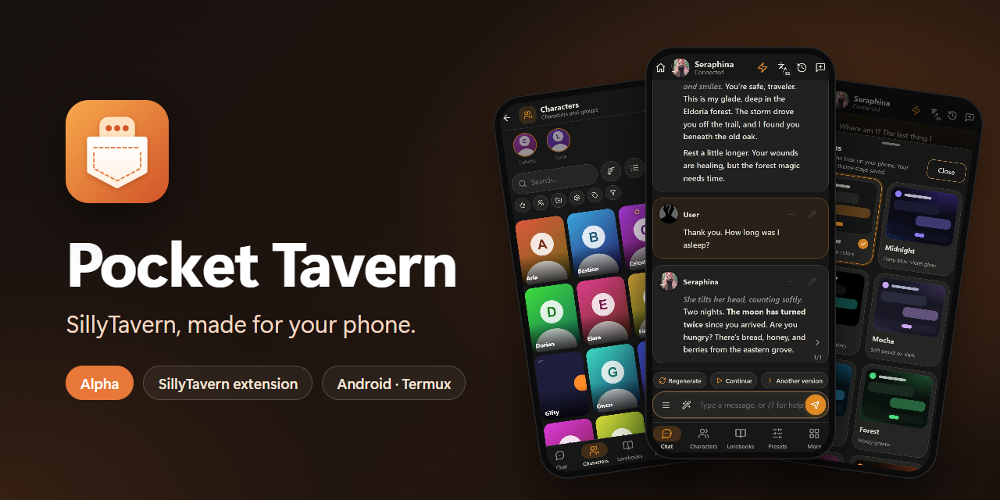</a>

# Pocket Tavern

[](CHANGELOG.md)
[](https://github.com/SillyTavern/SillyTavern)
[](#requirements)
[](LICENSE)
[](https://ko-fi.com/brabro)

**Pocket Tavern is a SillyTavern extension that makes it feel like a real app, on every device.** It has two layouts that share the same themes and features:

- **On phones** (Android, iPhone, and iPad held upright): tabs at the bottom, readable messages and buttons sized for your thumb.
- **On desktop** (computers, and tablets held sideways): a sidebar with every page, pages beside the chat and keyboard shortcuts.

It switches itself on and picks the right layout for each screen. Your characters, chats and lorebooks are never changed.

> [!WARNING]
> **Pocket Tavern is in alpha.** Things can change between updates and you may find bugs, so keep your own backups. If something breaks, [tell me](#feedback).

> [!IMPORTANT]
> After installing or updating, **reload the SillyTavern page** (twice if the old look is still there).

## Screenshots

| Chat | Characters | Character card |
| :---: | :---: | :---: |
| 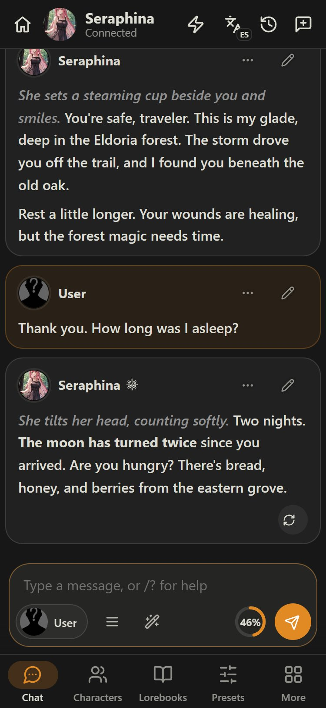 | 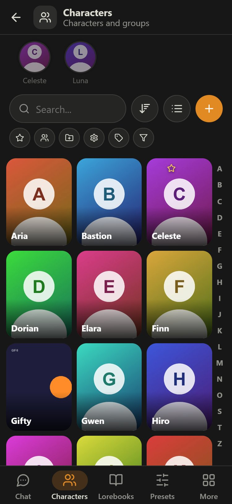 |  |
| **Compact size, docked message box** | **Themes** | **Context** |
| 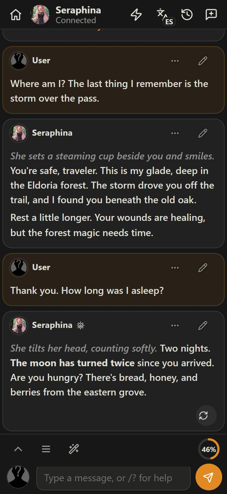 | 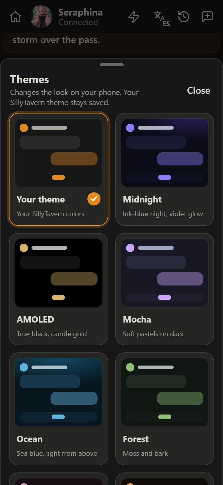 | 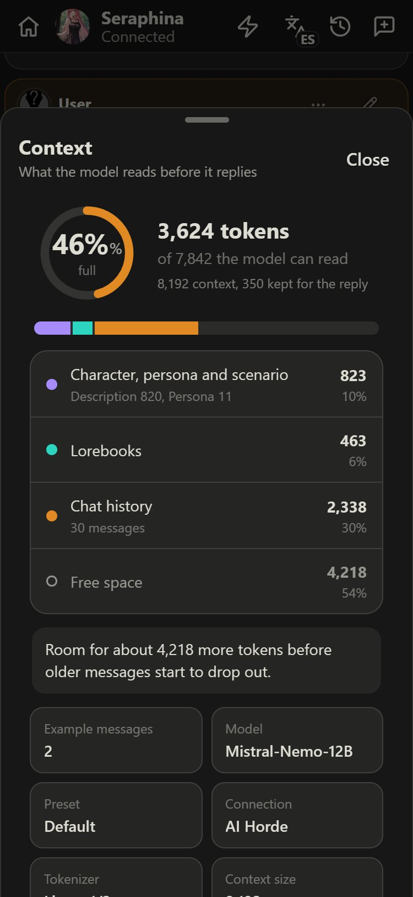 |

**On a computer:** every page sits on a sidebar on the left and opens beside the chat.


<details>
<summary>More screenshots</summary>

| Before (no Pocket Tavern) | Recent chats | Message editor |
| :---: | :---: | :---: |
|  |  | 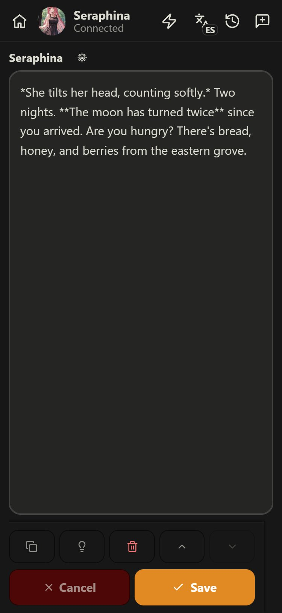 |
| **Tabs shown in a chat** | **Translated chat** | **Chat options (☰)** |
|  |  | 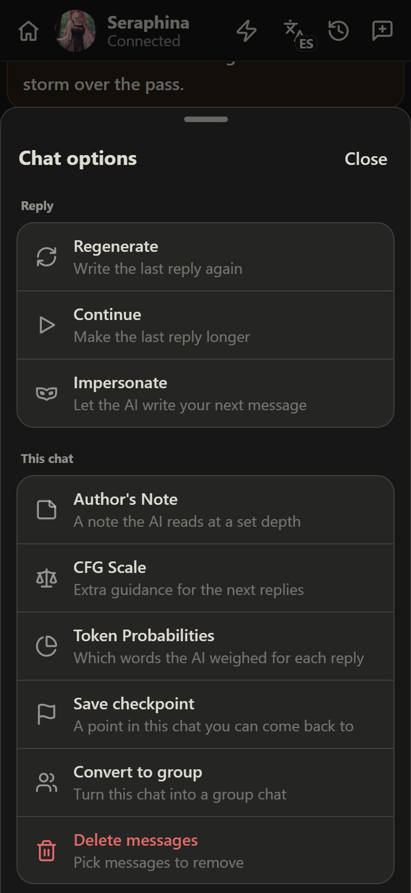 |
| **Settings** | **A settings section** | **More** |
| 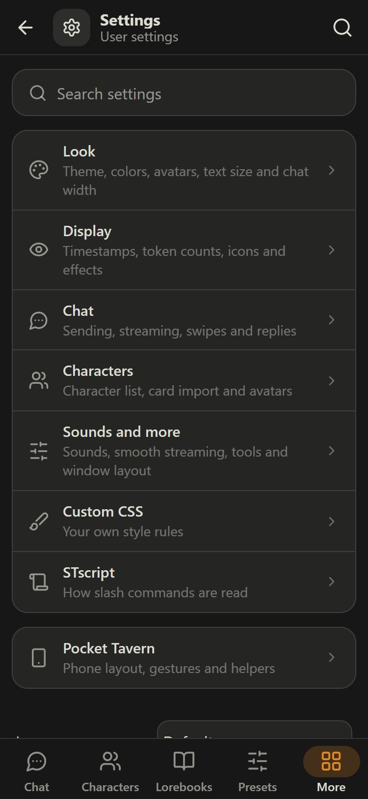 | 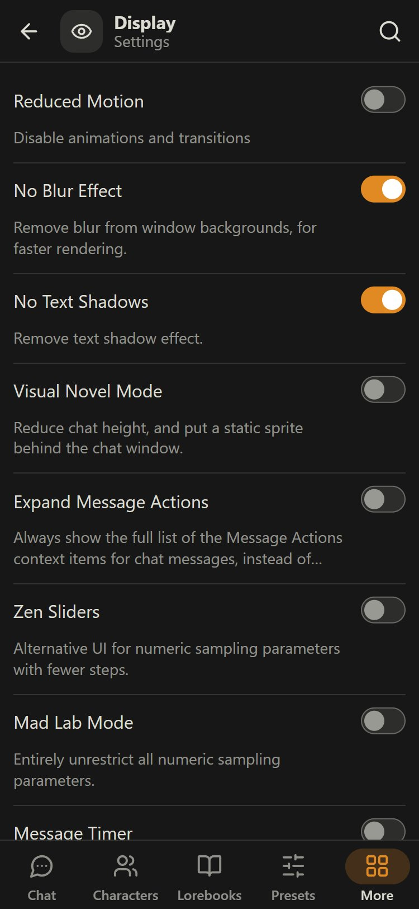 |  |
| **Lorebook picker** | **Lorebook entries** | **Presets** |
|  | 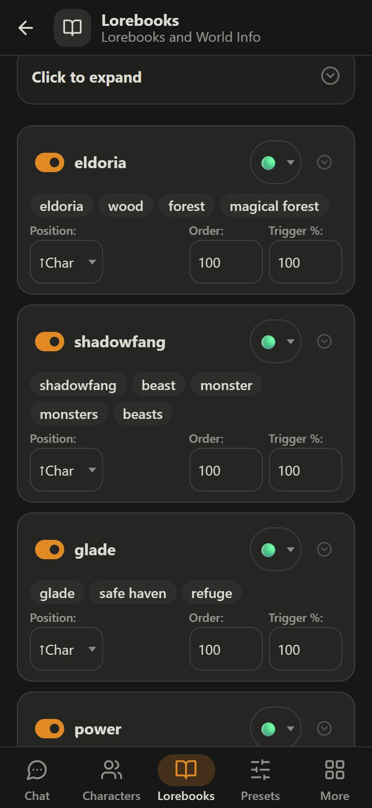 |  |
| **Prompt editor** | **Personas** | **Bubbles look** |
|  | 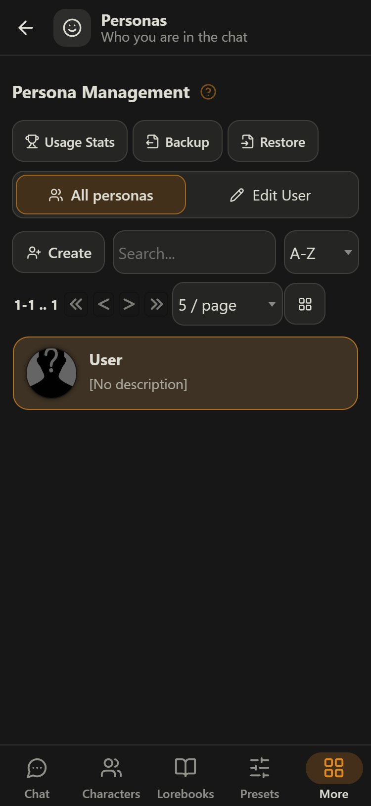 |  |
| **Midnight theme** | **Paper theme** | **Paper theme, compact** |
|  | 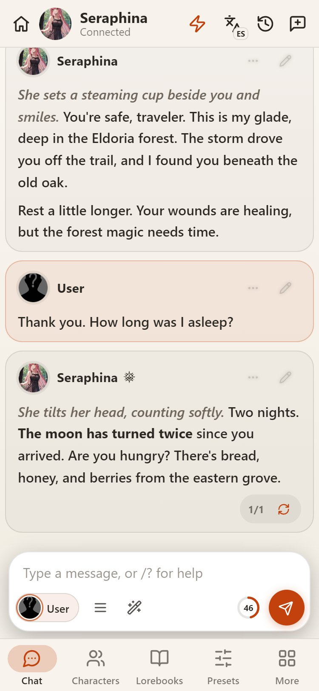 | 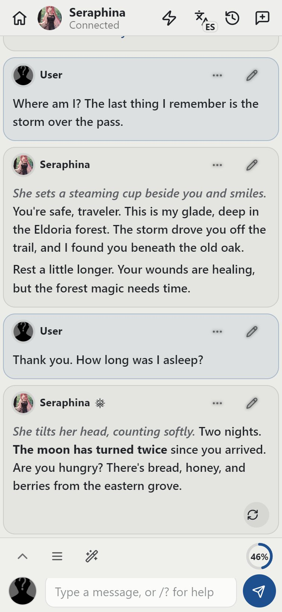 |
| **Glass over a chat background** | | |
| 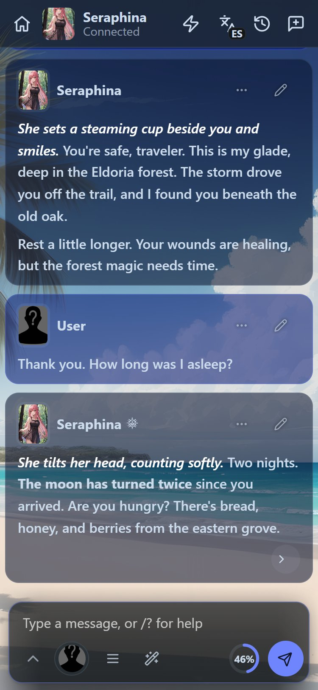 | | |

</details>

## Highlights

**📱 On your phone (Android, iPhone, iPad)**
- Tabs at the bottom for Chat, Characters, Lorebooks and Presets, with everything else under **More**. In a chat they tuck away; the arrow in the message box brings them back.
- Every page opens full screen, menus slide up from the bottom, and the back gesture closes whatever is open.
- Two sizes (**Comfortable** and **Compact**) and two message boxes (**Floating** and **Docked**).
- **More → Install as an app** puts SillyTavern on your home screen without the browser bar.

**💻 On desktop (computers, tablets held sideways)**
- A sidebar with every page: Chat, Characters, Lorebooks, Presets, API, Personas, Formatting, Settings, Backgrounds and Extensions.
- Pages open beside the chat and stay open while you chat. Drag a page's edge to make it wider.
- Compact like SillyTavern itself, so plenty of the chat fits (More → Themes → Size → Comfortable for more room).
- Author's Note, CFG and Token probabilities open in a column beside the chat.
- **Escape** closes things, and **Ctrl+K** opens Search everything.

**💬 Chatting**
- Clean message cards, swipes in a small ‹ 1/3 › pill (› on the last reply makes a new version), and drag the last reply sideways for another version.
- Your persona in the message box, and a context ring that shows how full the model's memory is.
- Edit a message on a full page, search the chat, translate it, and open pictures full screen.

**🗂️ Characters, personas, lorebooks and presets**
- Characters and personas as picture cards, with search, favorites and an A–Z strip.
- Character cards with tabs for Description, First message and Notes.
- Lorebook entries as cards with keyword chips, and a searchable picker.
- − and + beside every slider, a line on what each setting does, and a prompt editor with full screen.

**🎨 Make it yours**
- 12 themes (9 dark, 3 light), plus your SillyTavern themes made to fit. Over your chat background every theme turns to frosted glass.
- Cards, bubbles or flat messages, four text sizes, and animations you can turn down or off.
- Menus in English, Spanish, Portuguese, Russian, Chinese, Japanese and Arabic.

**⚡ Handy extras**
- **Quick switch:** change persona, connection, model or preset in two taps.
- **Search everything:** characters, chats, lorebooks and settings in one box.
- **Recent chats** grouped by character on the start screen, and an eye button there that hides the message box for more room.
- A banner when SillyTavern stops answering (handy with Termux).
- **Updates in one tap:** **More → Update Pocket Tavern**, and **More → SillyTavern updates** tells you when a new SillyTavern is out and how to update it.

Every helper has its own switch. The full list of changes is in [CHANGELOG.md](CHANGELOG.md).

## Requirements

- **SillyTavern 1.19** or newer.
- An up-to-date browser: Chrome on Android, Safari on iPhone and iPad, or any modern browser on a computer (Chrome, Edge, Firefox, Safari).
- **Git**, only if you install from Termux (`pkg install git`).

## Install

1. In SillyTavern, open **Extensions** (the stacked cubes), then **Install extension**.
2. Paste this link and install:
   ```
   https://github.com/brabro1/SillyTavern-PocketTavern
   ```
3. Reload the page.

<details>
<summary>Install from Termux instead</summary>

```bash
cd ~/SillyTavern/data/default-user/extensions
git clone https://github.com/brabro1/SillyTavern-PocketTavern
```

Then reload SillyTavern in your browser.

</details>

**Update:** **More → Update Pocket Tavern** (or **Extensions → Manage extensions**, then update Pocket Tavern). From version 2.21.0 on, the page reloads by itself once nothing is in progress (switch **Reload after updates** off to reload by hand). A short **What's new** list shows once.

**Remove:** **Extensions → Manage extensions**, then delete Pocket Tavern.

## Where to find things

| What | Where |
| --- | --- |
| Theme (Pocket Tavern's and your SillyTavern themes), chat look, size, message box, chat width, animations | **More → Themes** |
| Text size and every helper's switch | **More → Phone features** (**Features** on a computer) |
| Turn it on or off, or choose where it runs | **More → Pocket Tavern settings** |
| Search characters, chats, lorebooks and settings | **More → Search everything** (or **Ctrl+K** on a computer) |
| Update Pocket Tavern, or check for a new SillyTavern | **More → Update Pocket Tavern** / **More → SillyTavern updates** |

**Choose where it runs:** in Pocket Tavern settings, set "Use it on this device" to **Automatic** (phones and computers), **Phones only** (keeps the original SillyTavern on your computer) or **Off on this device**.

<details>
<summary>Start SillyTavern with one tap (Android and Termux)</summary>

Set this up once to get a SillyTavern icon on your home screen. Tap it and SillyTavern starts in Termux (if it isn't running yet) and opens in your browser when it's ready.

1. Install **Termux:Widget** from the same place you got Termux (for example F-Droid).
2. In Termux, run this once (use the folder name you see in your extensions folder):
   ```bash
   bash ~/SillyTavern/data/default-user/extensions/SillyTavern-PocketTavern/termux/setup.sh
   ```
   It asks whether to start SillyTavern whenever you open Termux, and when the phone turns on (that needs Termux:Boot).
3. Long-press your home screen, pick **Widgets → Termux:Widget**, and choose **SillyTavern**.

There are also **Update SillyTavern** (updates SillyTavern and starts it again) and **Stop SillyTavern** shortcuts. Already set up before? Run the command once more to get the update shortcut. Set Termux's battery use to **Unrestricted** in Android's settings so it isn't closed in the background. SillyTavern in another folder? Add `--dir ~/your-folder`. To undo everything, run the same command with `--remove`.

</details>

## FAQ

**Can I use it with SillyTavern on my PC or a server?**
Yes. Pocket Tavern runs in your browser, so install it on that SillyTavern and open its address on any device. Your phone gets the phone layout and your computer gets the desktop layout, with the same chats on both.

**Everything feels too big.**
Pick **Compact** under **More → Themes → Size**, and a smaller text size under **More → Phone features**.

**Where did the tabs go?**
In a chat they tuck away so you don't tap them by accident. Tap the arrow in the message box to bring them back, or turn off **Hide tabs in a chat** under **More → Phone features**.

**The page beside the chat is too narrow on my computer.**
Drag its right edge to make it wider; double-click the edge to reset it. For long prompts, the prompt editor has a full-screen button next to Save.

**Does it work with other extensions?**
Most of them. Their panels show up under **More**, and their buttons fit into the message box. Some get special care, listed under [Compatibility](#compatibility). If one doesn't work, [tell me](#feedback).

**I use Guided Generations. Where did its buttons go?**
They're in the guide button (the compass) next to Send. Hold it to repeat your last action. To get its own row back, turn off **Guided Generations button** under **More → Phone features**.

**Does it work on iPhone and iPad?**
Yes, they're supported just like Android. Safari's keyboard gets its own handling, so the bars, chat and editors stay in view while you type. An iPad held upright gets the phone layout, and held sideways the desktop layout; set the chat width under **More → Themes → Chat width**. To use it like an app, tap **Share → Add to Home Screen** in Safari.

**My chat background doesn't show.**
Pocket Tavern's own themes come with their own background. Pick a background on the **Backgrounds** page and Pocket Tavern switches to yours, or turn off **Theme background** under **More → Themes**. With a background showing, every theme turns to frosted glass so the picture shows everywhere. SillyTavern themes and **Your theme** always show your background.

**Where did SillyTavern's UI Theme list go?**
It moved to **More → Themes → From SillyTavern**. Every SillyTavern theme you have (and any you import there) shows up as a card. Over your background it keeps its own look (its glass, tints, blur and text shadow) in Pocket Tavern's layout, with the text kept readable. **Your theme** uses SillyTavern's colors exactly as they are, and **Settings → Look → Theme Colors** changes it. Pocket Tavern's chat look (cards, bubbles, flat) needs SillyTavern's Chat Style on **Flat**, and picking a look sets that for you.

**I don't want it on my computer.**
In Pocket Tavern settings, set "Use it on this device" to **Phones only**.

## Compatibility

| | Status |
| --- | --- |
| SillyTavern 1.19 or newer | ✅ Built and tested (older versions are not supported) |
| Android (Chrome), with or without Termux | ✅ Phone layout |
| iPhone and iPad (Safari) | ✅ Phone layout, with Safari's keyboard handled; iPad held sideways gets the desktop layout |
| Computers (Windows, macOS, Linux) | ✅ Desktop layout, in any up-to-date browser |
| Guided Generations | ✅ One guide button with a menu that explains every action |
| Input History, Quick Replies | ✅ Input History sits in the text field; quick replies are slim chips |
| Moonlit Echoes | ✅ Keep **Themes** on **Your theme**, and pick its chat styles under **Settings → Look → Chat Style** |
| ScenePulse | ✅ Opens from the wand (**Tools**) on a phone |
| Chat Completion Tabs | ✅ Its tabs match Pocket Tavern's |
| Other extensions | Work alongside it |

## Privacy

- Pocket Tavern only changes how SillyTavern looks. Your characters, chats, lorebooks and SillyTavern theme are never changed.
- Its settings are saved with your SillyTavern settings. Unsent messages and the page width you choose on a computer stay in your browser.
- **Translate** sends chat text to Google Translate straight from your browser, or, if you picked another service in SillyTavern's Chat Translation, to that service through your SillyTavern server.
- **More → SillyTavern updates** asks GitHub for the newest SillyTavern version when you open it. Nothing else is sent anywhere.

## Feedback

Found a bug or have an idea? [Open an issue](https://github.com/brabro1/SillyTavern-PocketTavern/issues/new/choose). A screenshot, your device and browser, your SillyTavern version and your other extensions help a lot. Pull requests are welcome too; see [CONTRIBUTING.md](CONTRIBUTING.md).

## Support

Pocket Tavern is free and always will be. If it makes your evenings with SillyTavern nicer and you'd like to say thanks, you can buy me a coffee on Ko-fi. Completely optional, and very much appreciated.

[](https://ko-fi.com/brabro)

## Credits and license

- **[SillyTavern](https://github.com/SillyTavern/SillyTavern)** (AGPL-3.0): the app Pocket Tavern is built for.
- **[Lucide](https://lucide.dev)** (ISC): the style of the icon set. See [THIRD_PARTY_NOTICES.md](THIRD_PARTY_NOTICES.md).
- Translation uses SillyTavern's **Chat Translation** and Google Translate.
- Written with the help of AI coding tools (Claude Code). Every change is tested on phone and desktop layouts before release.

Released under the [MIT](LICENSE) license.
