# Mobile UI for SillyTavern

Makes SillyTavern on your phone look and feel like a real app: tabs at the bottom, your character at the top, big readable text, and buttons sized for your thumb.

| Before | After |
| :---: | :---: |
| 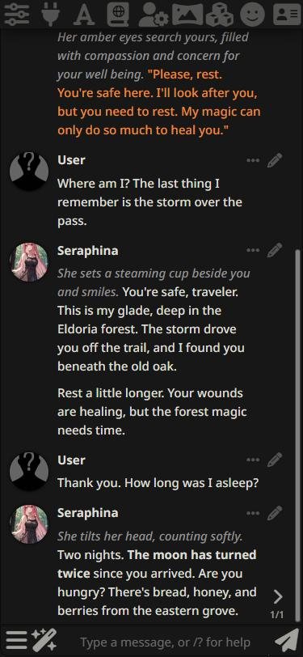 | 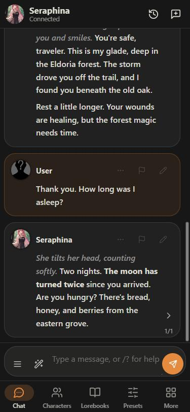 |

It only turns on for phones. On your computer SillyTavern looks the same as always.

## What you get

**Tabs at the bottom.** Chat, Characters, Lorebooks and Presets are one tap away. Everything else (API, Personas, Formatting, Settings, Backgrounds, Extensions) is under **More**.

**Your character at the top.** See who you're talking to and whether you're connected. Tap the name to open the character card. Buttons on the right open your chat history or start a new chat.

**The back gesture works.** Swiping back closes whatever is open (a menu, a popup, a page) instead of leaving SillyTavern.

**A cleaner chat.** Messages sit in soft cards with bigger text. The message box is rounded and the send button is easy to hit. While you type, the tabs step aside so you get more room.

**Pages that fit your screen.** Every panel opens full-screen with a clear title and a back arrow. Settings are grouped into cards, sliders are full-width with the number beside them, and nothing spills off the side of the screen.

**Menus and popups that come up from the bottom.** The ☰ menu, confirm boxes and chat history slide up from the bottom of the screen, within reach of your thumb.

**Easy lorebook picking.** Pick lorebooks from a searchable list with big checkboxes instead of the tiny two-line box. Remove one with the ✕ on its chip. It works for global, character, chat and persona lorebooks.

**Picking a character opens their chat.** Tap someone in the Characters list and you're in the conversation.

**12 themes to choose from.** Midnight, AMOLED, Mocha, Ocean, Forest, Sakura, Ember, Nord and Neon are dark. Paper, Cloud and Lavender are light. Each one recolors all of SillyTavern, and the new look spreads out from where you tap. Pick **Your theme** to keep your own SillyTavern colors. Your saved SillyTavern theme is never changed.

**New icons everywhere.** A matching set of rounded line icons replaces SillyTavern's mixed icons in the tabs, menus and every settings page.

**Smooth, light animations.** Pages slide in, the tab highlight glides between tabs, sheets spring up, and new messages fade in. Only cheap effects are used, so they stay smooth on a phone. Pick **Light** or **Off** if your phone is older or you prefer less motion.

**A send button with a little launch.** Tap send and the paper plane shoots off with a ripple, then lands back in the button.

**Recent chats that are easy to read.** On the start screen each chat is a card: the character, the chat's name, the date, the last message, and pin, rename and delete buttons.

**Personas on two tabs.** **All personas** to pick who you are, **Edit** to change the current one, with its picture and name at the top. No more scrolling past the whole list to reach the description.

**A prompt editor that fits.** Editing a prompt in Presets opens a full page. Long names wrap onto several lines, and Close, Reset and a big Save button stay at the bottom. The back arrow and the back gesture close it.

**Phone features** (under **More → Phone features**):

- **Message menu:** tap ⋯ on a message for every action with its name: copy, edit, branch, translate, delete and more.
- **Jump to latest:** a round button takes you back to the newest message when you scroll up.
- **Keep unsent messages:** what you type is kept for each chat, even if the browser reloads.
- **Keep screen on while replying:** the screen doesn't turn off while a reply is being written.
- **Chat text size:** Small, Normal, Large or Extra large.
- **Vibration:** a short buzz on send and tab taps.

| Recent chats | Prompt editor | Personas |
| :---: | :---: | :---: |
| 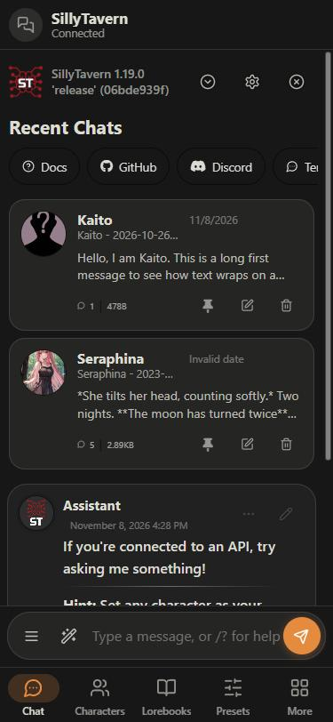 | 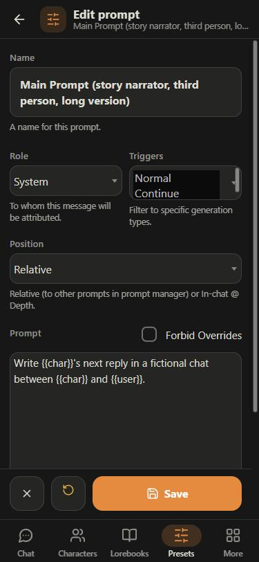 | 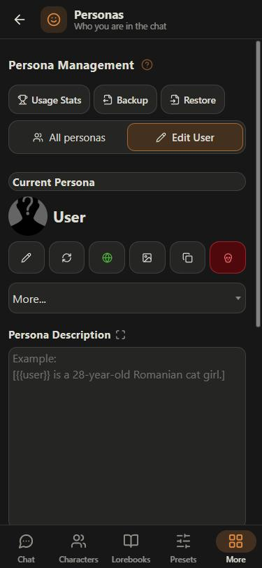 |

| Themes | Midnight | Paper |
| :---: | :---: | :---: |
| 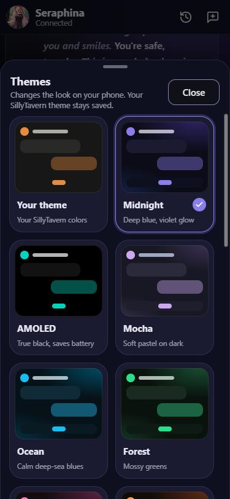 | 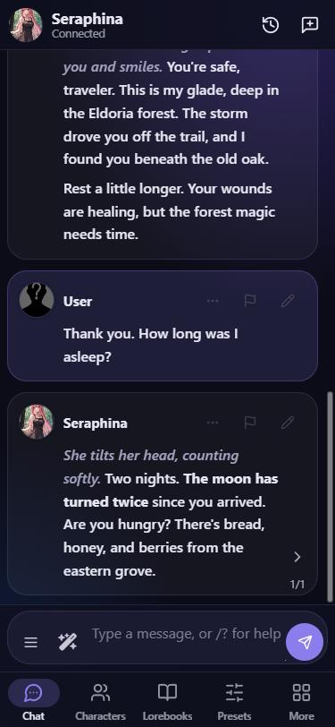 | 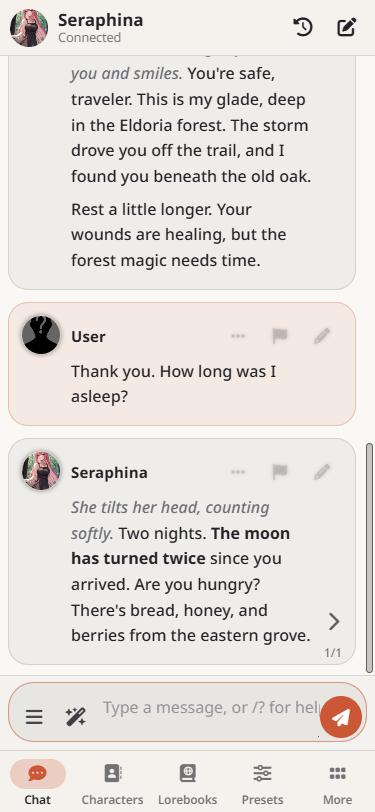 |

| Characters | More | Lorebooks |
| :---: | :---: | :---: |
| 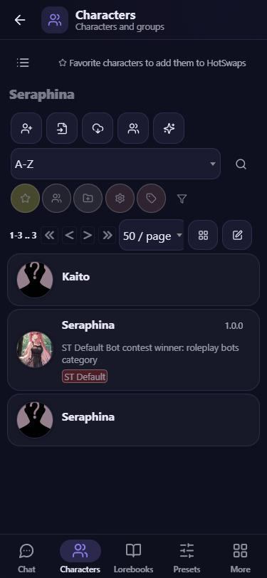 | 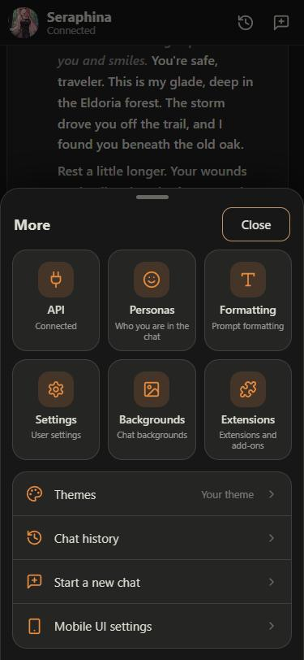 | 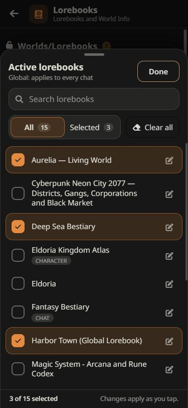 |

| Presets | ☰ menu |
| :---: | :---: |
| 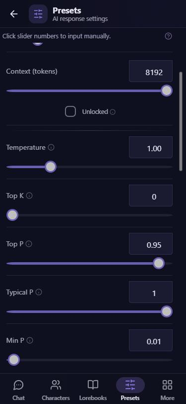 | 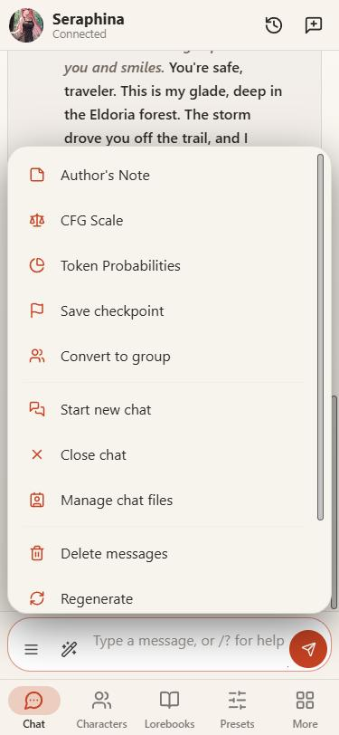 |

## Install

1. Open SillyTavern on your phone.
2. Tap the **Extensions** icon (the stacked cubes in the top bar), then **Install extension**.
3. Paste this link and tap install:
   ```
   https://github.com/brabro1/SillyTavern-Mobile-UI
   ```
4. Reload the page.

**Or from Termux:**

```bash
cd ~/SillyTavern/data/default-user/extensions
git clone https://github.com/brabro1/SillyTavern-Mobile-UI
```

Then reload SillyTavern in your browser. (Need git? Run `pkg install git` first.)

## Update

In SillyTavern: **More → Extensions → Manage extensions**, then tap update next to Mobile UI.

Or in Termux:

```bash
cd ~/SillyTavern/data/default-user/extensions/SillyTavern-Mobile-UI
git pull
```

Reload the page afterwards. If you still see the old look, reload once more. Chrome sometimes keeps the old files for a moment.

## Themes

Tap **More → Themes**. Tap any theme to switch right away. Below the themes you can also choose:

- **Theme background**: use the theme's backdrop, or keep your own chat background picture.
- **Modern font**: use your phone's own crisp system font.
- **New icons**: the rounded line icons, or SillyTavern's originals.
- **Animations**: **Smooth** (everything), **Light** (quick fades, no blur, faster on older phones) or **Off**.

## Phone features

Tap **More → Phone features** to choose the chat text size and switch each helper on or off. All of them are on to start with.

## Settings

Find them under **More → Mobile UI settings**. Each part can be switched on or off:

| Setting | What it does |
| --- | --- |
| Enable Mobile UI | Turns everything on or off. Off gives you the normal SillyTavern back. |
| Use it on this device | **Automatic** (phones only), **Always on** or **Off**. This is saved per device. |
| Theme, Animations, Theme background, Modern font, New icons | Same choices as in **More → Themes**. |
| Chat text size, Message menu, Jump to latest, Keep unsent messages, Keep screen on while replying, Send animation, Vibration | Same choices as in **More → Phone features**. |
| App navigation | The top bar and the bottom tabs. |
| Modern chat look | Message cards, bigger text, rounded message box. |
| Touch-friendly panels | Bigger buttons and sliders, roomier settings, menus from the bottom. |
| Back gesture closes panels | Android back closes the open page, popup or menu first. |
| Easy lorebook picker | The searchable lorebook list. |
| Lorebooks shortcut in the ✨ menu | Opens the lorebook list from the chat. |
| Searchable long dropdowns | Experimental: long dropdowns (models, presets) get the same searchable list. Off by default. |

**Phone not detected?** Set "Use it on this device" to **Always on**.

## Good to know

- Your characters, chats and lorebooks are never changed. Mobile UI only changes how things look and where buttons are.
- It works alongside your other extensions. Extensions that add their own panels show up under **More**.
- Made for SillyTavern 1.19. Use an up-to-date browser; it was built and checked with Chrome.
- The menus and labels are in English.

## Uninstall

**More → Extensions → Manage extensions**, then delete Mobile UI. To just pause it, untick **Enable Mobile UI**.

## License

MIT. The icon style follows [Lucide](https://lucide.dev) (ISC); see [THIRD_PARTY_NOTICES.md](THIRD_PARTY_NOTICES.md).
