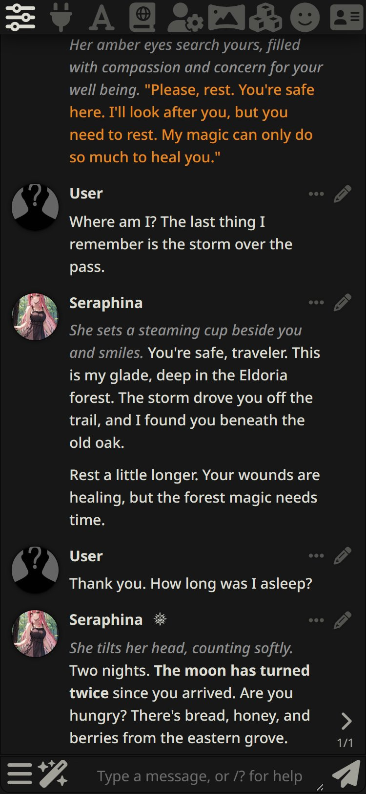
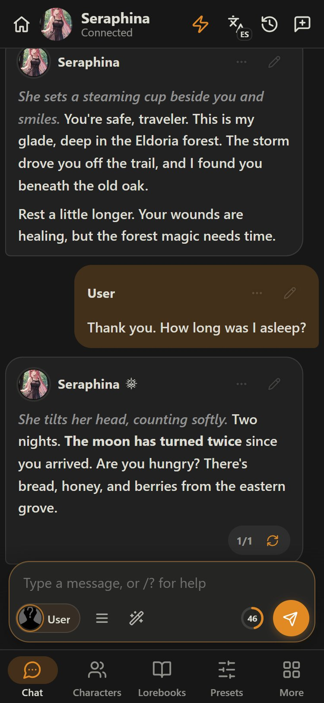
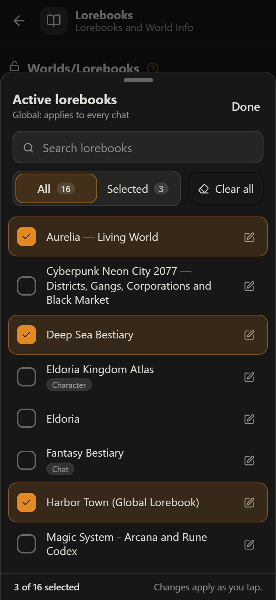
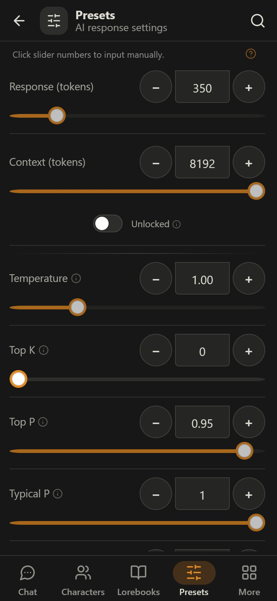
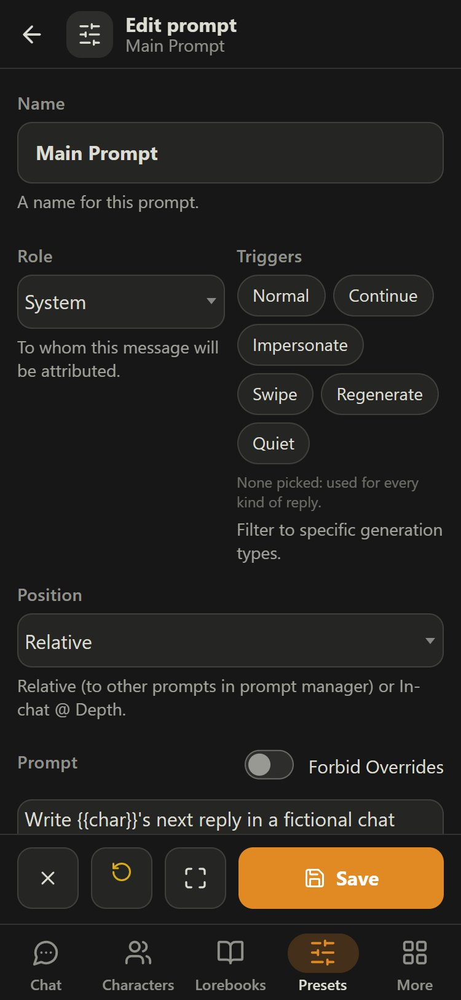

<a href="https://github.com/brabro1/SillyTavern-PocketTavern"></a>

# Pocket Tavern

[](CHANGELOG.md)
[](https://github.com/SillyTavern/SillyTavern)
[](#requirements)
[](LICENSE)

**Pocket Tavern makes SillyTavern on your phone look and feel like a real app.** Tabs at the bottom, your character at the top, big readable text, and buttons sized for your thumb. It's a SillyTavern extension that only switches on for phones. On your computer SillyTavern stays exactly as it is.

> [!WARNING]
> **Pocket Tavern is in alpha.** It's still being built, so things can change at any time, without notice. Expect bugs, rough edges and features that may move, change or disappear between updates. Your characters, chats and lorebooks are never changed, but please keep your own backups and don't rely on it as if it were finished. If something breaks, [tell me](#feedback-and-bug-reports).

> [!IMPORTANT]
> After installing or updating, **reload the SillyTavern page**. If the old look is still there, reload once more.

## Screenshots

| Chat | Characters | Character card |
| :---: | :---: | :---: |
|  |  |  |
| **Themes** | **Translated chat** | **Context** |
|  |  |  |

<details>
<summary>More screenshots</summary>

| Before (no Pocket Tavern) | Recent chats | Message editor |
| :---: | :---: | :---: |
|  |  |  |
| **Bubbles look** | **Midnight theme** | **Paper theme** |
|  |  |  |
| **Lorebook picker** | **Lorebook entries** | **Presets** |
|  |  |  |
| **Prompt editor** | **Personas** | **More** |
|  |  |  |

</details>

## Highlights ✨

### Feels like an app
- **Tabs at the bottom:** Chat, Characters, Lorebooks and Presets are one tap away. Everything else is under **More**.
- **Your character at the top:** see who you're talking to and whether you're connected. Tap the name for the character card.
- **The back gesture works:** swiping back closes the open menu, popup or page instead of leaving SillyTavern.
- **Pages that fit:** every panel opens full screen with a title and a back arrow. Menus and popups slide up from the bottom, within reach of your thumb.
- **Install it like an app:** **More → Install as an app** puts SillyTavern on your home screen, full screen without the browser bar.
- **Light on your phone:** typing, scrolling and pages are measured on a phone-speed CPU and kept smooth, even in long chats. Older phone? Pick **Light** animations under **More → Themes**.

### Chatting
- **A cleaner chat:** soft message cards (or bubbles, or flat) and bigger text. Drag the last reply sideways to swipe.
- **A floating message box:** your text gets the whole width, with the tools in a row underneath. Your persona sits there as a little picture with your name: tap it to switch who you are.
- **Context ring:** a ring in the message box fills up as the chat uses more of the model's memory. Tap it for the Context page: what filled it (character, lorebooks, examples, chat history), how much room is left, the model and preset, and the full prompt.
- **Edit on a full page:** tap ✎ and the message opens full screen, with Save right above the keyboard.
- **Search this chat:** find any word in the conversation and jump between matches.
- **One-tap translate:** tap the translate button to see the chat in your language, tap again for the original. Hold it to pick a language. Even long chats change in about a second.
- **Full-screen pictures:** tap an avatar to see it full size. Pinch to zoom, rotate or save.

### Characters, lorebooks and presets
- **Characters page made for your thumb:** search, sort, grid or list, favorites on top and an A–Z strip for jumping.
- **Sharp pictures, even animated ones:** full-quality pictures instead of blurry thumbnails, and GIF or animated WebP pictures that move.
- **Character cards with tabs:** Description, First message and Notes & tags, each with the whole page.
- **Easy lorebook picking:** a searchable list with big checkboxes. Lorebook entries show as cards with keyword chips.
- **Easier presets:** − and + buttons on sliders, prompt triggers as chips and a prompt editor that fits the screen.

### Everything else
- **12 themes:** 9 dark and 3 light, or keep your own SillyTavern colors. New rounded icons and smooth, light animations.
- **Quick switch (⚡):** change persona, connection profile, model or preset in two taps.
- **Search everything:** characters, chats, lorebooks and settings in one search box. On settings pages, 🔍 finds any option by name.
- **Know when Termux stopped:** a banner shows when SillyTavern stops answering and goes away when it's back.
- **Your language:** Pocket Tavern's menus come in English, Spanish, Portuguese, Russian, Chinese, Japanese and Arabic.

Every helper can be switched off under **More → Phone features**. The full list of changes is in [CHANGELOG.md](CHANGELOG.md).

## Requirements

- **SillyTavern 1.19** or newer.
- **A phone browser.** It's built and checked with Chrome on Android. Other up-to-date phone browsers should work but get less testing.
- **Git** if you install from Termux (`pkg install git`).

## Installation

1. Open SillyTavern on your phone.
2. Tap the **Extensions** icon (the stacked cubes), then **Install extension**.
3. Paste this link and tap install:
   ```
   https://github.com/brabro1/SillyTavern-PocketTavern
   ```
4. Reload the page.

<details>
<summary>Install from Termux instead</summary>

```bash
cd ~/SillyTavern/data/default-user/extensions
git clone https://github.com/brabro1/SillyTavern-PocketTavern
```

Then reload SillyTavern in your browser.

</details>

**Phone not detected?** Open **More → Pocket Tavern settings** and set "Use it on this device" to **Always on**.

### Updating

**More → Extensions → Manage extensions**, then tap update next to Pocket Tavern. Reload the page afterwards. After an update a short **What's new** list shows once.

### Turning it off or uninstalling

To pause it, untick **Enable Pocket Tavern** in its settings and you get the normal SillyTavern back. To remove it, go to **More → Extensions → Manage extensions** and delete Pocket Tavern.

## Start SillyTavern with one tap (Android)

Set this up once and you get a SillyTavern icon on your home screen. Tap it and SillyTavern starts in Termux (if it isn't running yet) and opens in your browser when it's ready.

1. Install **Termux:Widget** from the same place you got Termux (for example F-Droid).
2. In Termux, run this once (use the folder name you see in your extensions folder):
   ```bash
   bash ~/SillyTavern/data/default-user/extensions/SillyTavern-PocketTavern/termux/setup.sh
   ```
   It asks whether to start SillyTavern whenever you open Termux, and when the phone turns on (that needs Termux:Boot).
3. Long-press your home screen, pick **Widgets → Termux:Widget**, and choose **SillyTavern**.

There's also a **Stop SillyTavern** shortcut. In Android's settings, set Termux's battery use to **Unrestricted** so Android doesn't close it in the background. Installed SillyTavern somewhere else? Add `--dir ~/your-folder`. To undo everything, run the same command with `--remove`.

## Settings

- **More → Themes:** theme, chat look (Cards, Bubbles, Flat), theme background, modern font, new icons and animations (Smooth, Light or Off).
- **More → Phone features:** chat text size and every helper, one switch each.
- **More → Pocket Tavern settings:** turn it all on or off, choose when it switches on (Automatic, Always on, Off) and the bigger building blocks like the bottom tabs and touch-friendly panels.

## Compatibility

| | Status |
| --- | --- |
| SillyTavern 1.19 | ✅ Built and tested |
| Older SillyTavern | Not supported |
| Chrome on Android (also with Termux) | ✅ Main target |
| Other phone browsers | Should work, less tested |
| Computers and tablets | Stays off, unless you choose **Always on** |
| Other extensions | Work alongside it. Extensions with their own panels show up under **More**. |

## Privacy and your data

- Pocket Tavern only changes how SillyTavern looks and where buttons are. Your characters, chats, lorebooks and saved SillyTavern theme are never changed.
- Its settings are saved with your SillyTavern settings. Unsent messages are kept in your browser.
- **Translate** sends the chat text from your phone to Google Translate, or to the service you picked in SillyTavern's Chat Translation. Nothing else is sent anywhere.

## Status and roadmap

Pocket Tavern is in **alpha**: the main pages are in place, but parts are still being reworked and tested on more phones. Ideas are welcome.

## Feedback and bug reports

Found a bug or have an idea? [Open an issue](https://github.com/brabro1/SillyTavern-PocketTavern/issues/new/choose). A screenshot, your phone and browser, and your SillyTavern version help a lot.

## Contributing

Pull requests are welcome. See [CONTRIBUTING.md](CONTRIBUTING.md) for how to run the checks.

## Credits

- **[SillyTavern](https://github.com/SillyTavern/SillyTavern)** (AGPL-3.0): the app Pocket Tavern is built for.
- **[Lucide](https://lucide.dev)** (ISC): the style of the icon set. See [THIRD_PARTY_NOTICES.md](THIRD_PARTY_NOTICES.md).
- Translation uses SillyTavern's built-in **Chat Translation** and Google Translate.

## AI usage

Pocket Tavern is written with the help of AI coding tools (Claude Code). Every change is tested on a phone layout before it's released.

## License

[MIT](LICENSE)
