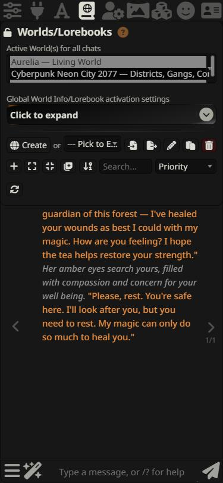
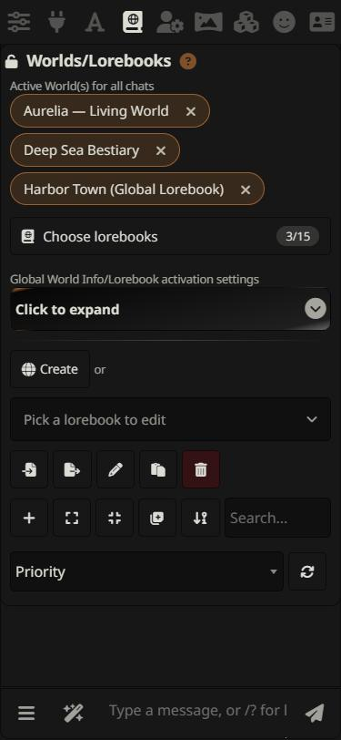
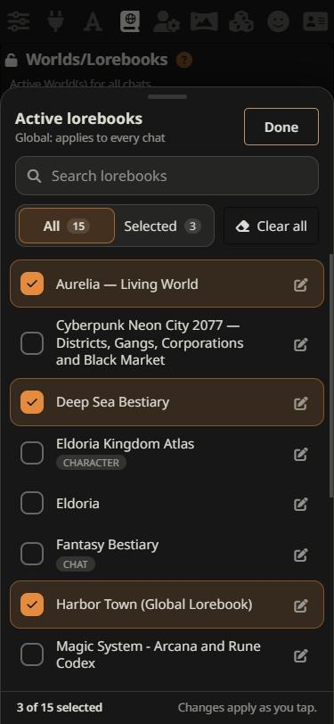
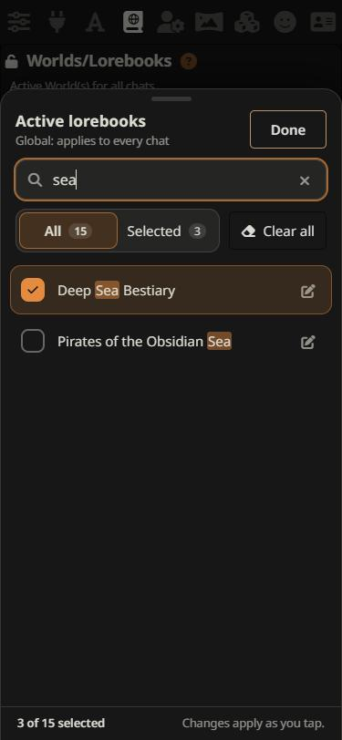
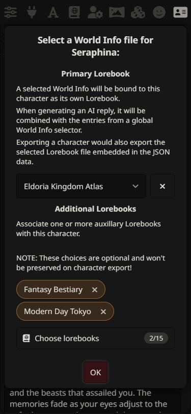
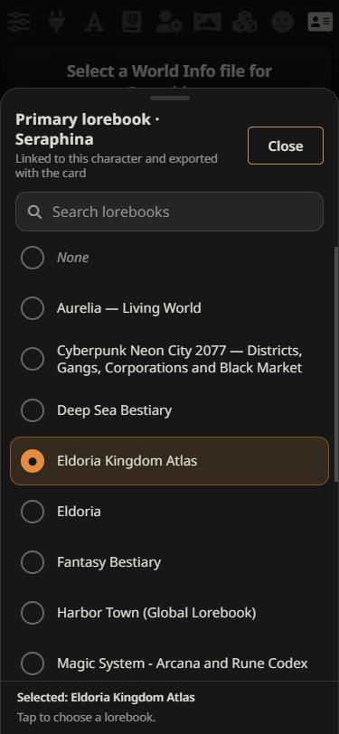
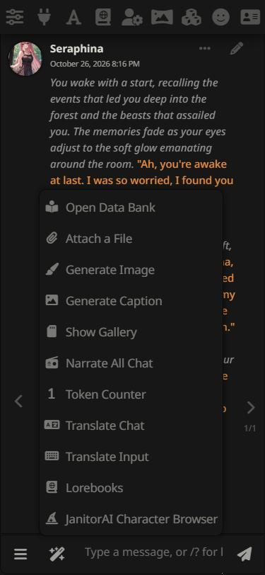
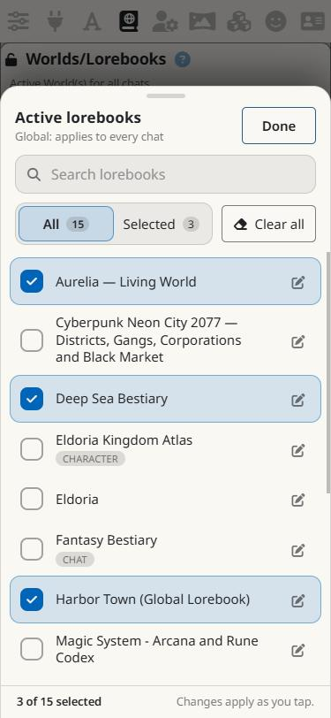

# Mobile UI for SillyTavern

A phone-only touch layer for [SillyTavern](https://github.com/SillyTavern/SillyTavern). It makes the mobile interface easier to read and operate with a thumb, and it **fixes lorebook selection on phones** with a searchable bottom sheet instead of the cramped native multi-select.

It is a normal third-party UI extension: no core files are edited, nothing is patched, and turning it off puts the stock interface back exactly as it was.

| Stock phone UI | With Mobile UI | Searchable sheet |
| :---: | :---: | :---: |
|  |  |  |

## Why

On phones SillyTavern deliberately skips its searchable dropdown (`select2`) and falls back to the browser's raw `<select multiple>`. In Android Chrome that shows a two-row window with clipped names, tiny hit areas and no search, which is painful once you have more than a handful of lorebooks.

## Features

### Lorebook picker (the main feature)

Every lorebook selector gets the same touch-friendly control. The original `<select>` stays in the page, hidden. The sheet reads from it and writes to it, then fires a normal `change` event, so **SillyTavern applies selections exactly as it always did**. Lorebook files and their data are never touched.

| Where | Kind | What you get |
| --- | --- | --- |
| World Info panel: *Active World(s) for all chats* | multi | Chips with a one-tap remove, plus a sheet. Rows have an edit button that opens that lorebook in the editor. Rows show `Character` / `Chat` badges when a book is also linked to the current character or chat. |
| World Info panel: *Pick to edit* | single | Full-width readable button and a searchable sheet |
| Character lorebook popup: *Primary Lorebook* | single | Sheet with a `None` row and a one-tap clear button |
| Character lorebook popup: *Additional Lorebooks* | multi | Chips and sheet |
| Chat lorebook popup | single | Sheet |
| Persona lorebook popup | single | Sheet |

The sheet gives you:

- full lorebook names that wrap instead of being clipped
- live search with highlighted matches
- an **All / Selected** filter and a **Clear all** button for multi-selects
- clear checked / unchecked states, with immediate feedback (selections apply as you tap, matching how SillyTavern's own controls behave)
- swipe down, tap outside, **Done**, or the Android back gesture to close
- a layout that shrinks above the on-screen keyboard and goes compact in landscape
- a **Lorebooks** shortcut in the wand (✨) menu, so the global list is two taps away from the chat



Character-linked selectors keep their meaning. The sheet title names the context ("Primary lorebook · Seraphina", "Linked to this character and exported with the card" versus "not exported with the card").

| Character popup | Single-choice sheet | Wand shortcut |
| :---: | :---: | :---: |
|  |  |  |

### Touch sizing and layout

- Top bar and send bar grow to 46–52 px tall, with full-height tap targets
- Inputs and selects are at least 44 px tall and use 16 px text
- Checkboxes and radios are larger, and sliders keep their look but get a much taller grab area and a bigger thumb
- Drawer headers, menu buttons, wand and options menu rows reach finger size
- Safe-area insets (notch, gesture bar) respected on the top bar, send bar and sheets
- Dialogs, drawers, code blocks, tables and images are capped to the visible screen so nothing scrolls sideways
- Smaller bars in landscape to keep room for the chat

### Theme integration

Everything uses SillyTavern's own `--SmartTheme*` variables (text, surface and accent colors), so it follows whichever theme you pick.



### Optional: searchable sheet for long dropdowns (experimental, off by default)

Turn on *Searchable sheet for long dropdowns* and any single-choice dropdown with 14 or more options (model lists, presets, languages…) uses the same sheet. It is off by default because the native Android menu is fine for short lists and a few extensions manage their own selects.

## Settings

Extensions panel → **Mobile UI**

| Setting | Default | Notes |
| --- | --- | --- |
| Enable Mobile UI | on | Master switch. Off removes every injected element and CSS rule. |
| Activation (this device only) | Automatic: phones only | Stored in this browser's `localStorage`, so your phone and your PC can differ even on one server. *Always on* forces it on, *Off* disables it on this device. |
| Touch lorebook picker | on | The sheet and chips described above. |
| Lorebooks shortcut in the wand menu | on | |
| Larger touch targets and safe-area spacing | on | The general sizing pass. |
| Searchable sheet for long dropdowns | off | Experimental. |

The panel also shows whether a phone was detected.

### How "phone" is detected

Automatic mode activates when the device has a coarse pointer (or `hover: none`) **and** its physical screen is 500 CSS px or less on the short side, or when the user agent is an Android phone or iPhone. Because it looks at the *screen* and not the window size, it keeps working in landscape and in Chrome's *Desktop site* mode, while tablets, desktops and narrow desktop windows stay on the stock interface. If your phone is not detected, pick **Always on**.

## Installation

Developed and tested against **SillyTavern 1.19.0**. Other recent versions should work because it only relies on the stock lorebook `<select>` elements and the public extension API, but I have not verified them. Use a current Chromium-based or Firefox mobile browser: the CSS uses `color-mix()`, `:has()` and `dvh`, which have shipped in Chrome and Firefox since 2023.

### Option A: from the SillyTavern UI (works in Termux too)

1. Open SillyTavern in your phone's browser.
2. Extensions (puzzle icon) → **Install extension**.
3. Paste `https://github.com/brabro1/SillyTavern-Mobile-UI` and confirm.
4. Reload the page.

### Option B: manual, from the Termux shell

```bash
cd ~/SillyTavern/data/default-user/extensions
git clone https://github.com/brabro1/SillyTavern-Mobile-UI
```

Use your own SillyTavern folder if it is not `~/SillyTavern`, and your own user folder if it is not `default-user`. Then reload the page. To install for every user, clone into `public/scripts/extensions/third-party` instead.

If you have not installed `git` in Termux yet: `pkg install git`.

### Update

Either use Extensions → **Manage extensions** → update, or:

```bash
cd ~/SillyTavern/data/default-user/extensions/SillyTavern-Mobile-UI
git pull
```

Then reload the page. Android Chrome caches scripts aggressively; if you do not see the change, reload twice or clear the site's cache (Chrome → ⋮ → Settings → Site settings → the site → Clear & reset).

### Uninstall

Extensions → Manage extensions → remove, or delete the `SillyTavern-Mobile-UI` folder and reload. To only switch it off, untick **Enable Mobile UI**.

## Compatibility and safety

- No SillyTavern files are modified. It uses `SillyTavern.getContext()`, the extension settings store, the wand menu container, and the Extensions panel.
- Every style that changes the stock interface is scoped to `html.stmui-on`. With the extension off, that class is never set.
- The pickers never replace SillyTavern's selects. They hide and mirror them, so slash commands such as `/world`, other extensions, and SillyTavern's own handlers keep seeing the real control, and the sheet re-syncs when they change it.
- The sheet is a native `<dialog>`, so it opens above SillyTavern's own popups.
- SillyTavern closes unpinned drawers on any outside tap. The sheet stops those two events so the lorebook drawer stays open behind it.
- Lightweight: one script and one stylesheet, no dependencies, no network requests. One small `MutationObserver` watches for new lorebook selects and ignores anything inside the chat.

## Known limitations

- **Not tested on a physical Android phone by the author yet.** See below for what was and was not covered.
- Text is English only; SillyTavern's translation system is not hooked in.
- Chrome's *Desktop site* mode gives the page a ~980 px layout, so the stock desktop layout is used; the pickers still work if you choose *Always on*, but the sizing pass is tuned for a phone-width layout.
- The top bar still holds nine icons, so each is about 40 px wide on a 360 px phone (and 46 px tall).
- The long-dropdown sheet is a best-effort convenience: titles come from the nearest label and a few unusual controls may show a generic title.
- The touch-sizing pass cannot know every third-party extension's markup, so a few extension panels may keep their own small controls.

## What was tested

Browser-emulated (Chromium in the Claude desktop app, SillyTavern 1.19.0, Android Chrome user agent and touch emulation for the *mobile* preset):

- 375×812 phone preset: automatic detection activates; all lorebook selectors, touch sizing, wand shortcut, settings panel
- 320×568 small phone, 320×290 and 600×290 short viewports (stand-ins for keyboard-open and landscape, since the pane cannot raise a real keyboard)
- Lorebook selection through real clicks and typing: select, deselect, search, clear all, filter, remove from chip, primary / extra / chat / persona lorebook; the resulting SillyTavern state (`selected_world_info`, `charLore`, `chat_metadata`, `extensions.world`, `persona_description_lorebook`) was read back and matched
- Sheet over a SillyTavern popup (character lorebook dialog), back gesture via `history.back()`, swipe-to-dismiss via synthetic touch events, Escape/cancel
- `/world state=on|off …` changing the global list from outside the sheet: the chips updated
- Enable / disable round trip: the stock metrics (35 px bars, native select visible) came back exactly and no elements or classes were left behind
- Desktop and narrow desktop windows: detection stays off and select2 is untouched; forced *Always on* works alongside select2
- A light theme (by overriding the `--SmartTheme*` variables)

**Not tested on real hardware:** an actual Android phone and Termux session, the real on-screen keyboard, the Android back gesture, notch and gesture-bar insets, Samsung Internet and Firefox for Android, and a real tablet. Please open an issue if anything looks off on your device and include your browser and screen size.

## Development

```bash
git clone https://github.com/brabro1/SillyTavern-Mobile-UI
```

Symlink or copy the folder into `data/default-user/extensions/`, then use your browser's device emulation (or *Always on*) to work on it. Files:

| File | Purpose |
| --- | --- |
| `manifest.json` | Extension manifest |
| `index.js` | Detection, settings, lorebook pickers, bottom sheet |
| `style.css` | Sheet styling and the touch-sizing layer (scoped to `html.stmui-on`) |

## License

MIT
