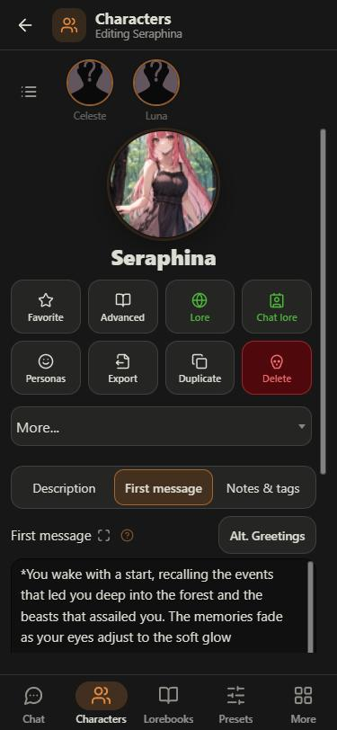
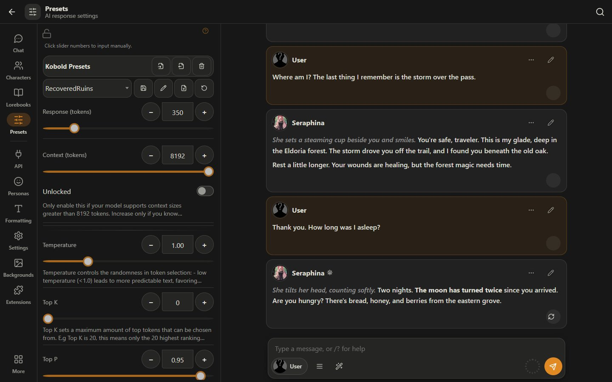
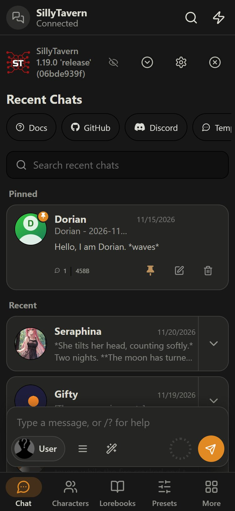
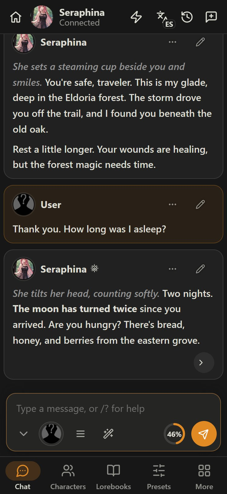
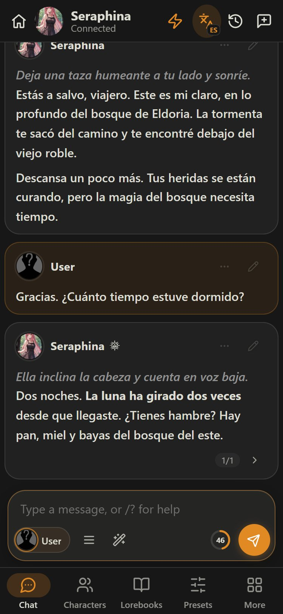
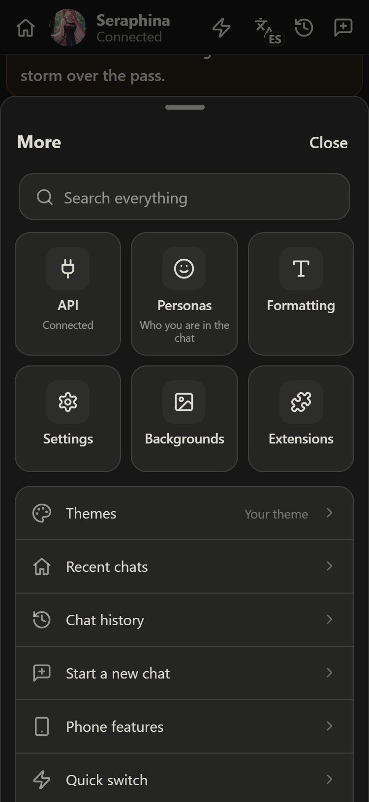
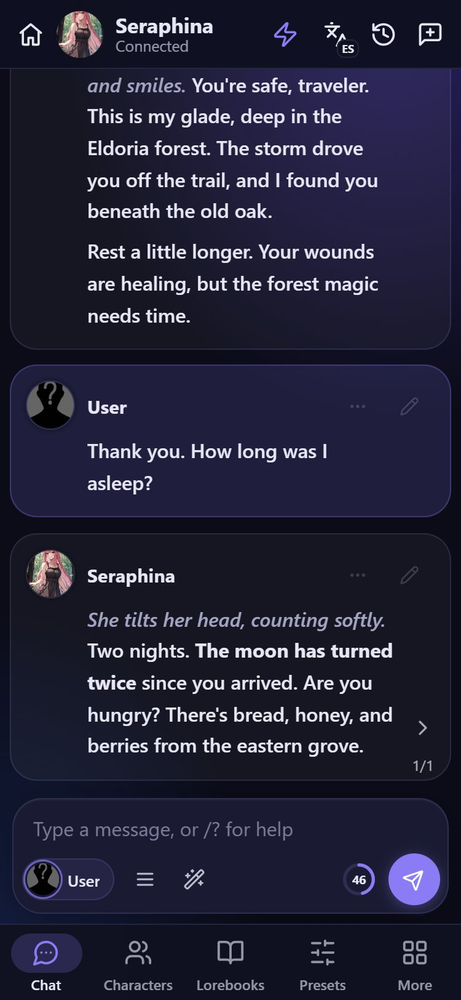

<a href="https://github.com/brabro1/SillyTavern-PocketTavern"></a>

# Pocket Tavern

[](CHANGELOG.md)
[](https://github.com/SillyTavern/SillyTavern)
[](#requirements)
[](LICENSE)
[](https://ko-fi.com/brabro)

**Pocket Tavern makes SillyTavern on your phone feel like a real app.** Tabs at the bottom, your character at the top, readable messages, menus that slide up from the bottom, and buttons sized for your thumb. It's a SillyTavern extension, and it switches itself on: phones get the phone layout, and computers get a desktop layout of their own.

It's made for phones first. The desktop layout is newer and may still have rough edges.

> [!WARNING]
> **Pocket Tavern is in alpha.** It's still being built, so things can change between updates, and you may run into bugs. It never changes your characters, chats or lorebooks, but please keep your own backups. If something breaks, [tell me](#feedback-and-bug-reports).

> [!IMPORTANT]
> After installing or updating, **reload the SillyTavern page**. If the old look is still there, reload once more.

## Screenshots

| Chat | Characters | Character card |
| :---: | :---: | :---: |
|  |  |  |
| **Compact size, docked message box** | **Themes** | **Context** |
|  |  |  |

**On a computer:** the tabs become a rail on the left, and pages open beside the chat.



<details>
<summary>More screenshots</summary>

| Before (no Pocket Tavern) | Recent chats | Message editor |
| :---: | :---: | :---: |
|  |  |  |
| **Tabs shown in a chat** | **Translated chat** | **Chat options (☰)** |
|  |  |  |
| **Settings** | **A settings section** | **More** |
|  |  |  |
| **Lorebook picker** | **Lorebook entries** | **Presets** |
|  |  |  |
| **Prompt editor** | **Personas** | **Bubbles look** |
|  |  |  |
| **Midnight theme** | **Paper theme** | **Paper theme, compact** |
|  |  |  |

</details>

## What you get ✨

### An app, not a web page
- **Tabs at the bottom:** Chat, Characters, Lorebooks and Presets, one tap away. Everything else is under **More**. In a chat the tabs tuck away so they're not right under the message box; the arrow in the message box brings them back.
- **Your character at the top:** who you're talking to and whether you're connected. Tap the name for the character card.
- **Back works:** the back gesture closes the open menu, popup or page instead of leaving SillyTavern.
- **Pages that fit:** every panel opens full screen with a title and a back arrow, and menus slide up from the bottom, within reach of your thumb.
- **Settings that make sense:** SillyTavern's Settings page opens on a short list of sections (Look, Display, Chat, Characters and more), like your phone's own Settings app. Every option has a line under it saying what it does.
- **Install it like an app:** **More → Install as an app** puts SillyTavern on your home screen, full screen without the browser bar.

### Make it yours
- **Two sizes:** **Comfortable** is roomy, **Compact** fits more of the chat with slimmer bars, cards and buttons. **Automatic** picks Compact on small phones.
- **Two message boxes:** **Floating** floats over the chat; **Docked** is a bar along the bottom like a messaging app, with your persona, the text and Send in one row.
- **12 themes**, 9 dark and 3 light, or keep your own SillyTavern colors. Cards, bubbles or flat messages, four text sizes, and animations you can turn down to Light or Off.

### Chatting
- **Messages made for a phone:** the text runs across the whole card, with the picture, name and date in a small header. Swipes sit in a small ‹ 1/3 › pill, and you can drag the last reply sideways for another version. The model's thinking folds into a box you can open.
- **Your persona in the message box:** tap it to switch who you are, or to edit your persona on the spot.
- **Context ring:** fills up as the chat uses more of the model's memory. Tap it to see what filled it and how much room is left.
- **Edit on a full page:** tap ✎ and the message opens full screen, with Save right above the keyboard.
- **Search and translate:** find any word in the chat, or see the whole chat in your language with one tap.
- **Full-screen pictures:** tap an avatar to see it big. Pinch to zoom, rotate or save.

### Characters, lorebooks and presets
- **Characters:** picture cards, search, sort, favorites on top, an A–Z strip, and page buttons when you have lots of characters. Sharp pictures, and GIFs that move.
- **Character cards with tabs:** Description, First message and Notes, each with the whole page.
- **Lorebooks:** a searchable picker with big checkboxes, and entries as cards with keyword chips.
- **Presets:** − and + buttons on sliders, a line under each one on what it does, and a prompt editor that fits the screen.

### On a computer
- **A desktop layout of its own:** the tabs become a rail on the left, pages open as a panel beside the chat and stay open while you chat, and menus are dialogs in the middle. Escape closes things.
- **Tablets and unfolded foldables** get the chat as a centred column that's easy to read.

### Everything else
- **Quick switch (⚡):** change persona, connection, model or preset in two taps.
- **Recent chats by character:** one card per character on the start screen, with their latest chat and the rest one tap away.
- **Search everything:** characters, chats, lorebooks and settings in one search box.
- **Know when Termux stopped:** a banner shows when SillyTavern stops answering.
- **Your language:** Pocket Tavern's menus come in English, Spanish, Portuguese, Russian, Chinese, Japanese and Arabic.
- **Guided Generations, made for a phone:** if you use it, its row of icons becomes one guide button next to Send. It opens a menu that shows your instruction and explains every action, and its guides, tools and popups fit the screen. Hold the button to repeat your last guided action.

Every helper can be switched off under **More → Phone features**. The full list of changes is in [CHANGELOG.md](CHANGELOG.md).

## Requirements

- **SillyTavern 1.19** or newer.
- **A phone browser.** It's built and checked with Chrome on Android. Safari on iPhone and iPad has its own handling for the keyboard and gets checked too, but less. Other up-to-date browsers should work.
- **Git** if you install from Termux (`pkg install git`).

## Installation

1. Open SillyTavern.
2. Tap the **Extensions** icon (the stacked cubes), then **Install extension**.
3. Paste this link and tap install:
   ```
   https://github.com/brabro1/SillyTavern-PocketTavern
   ```
4. Reload the page.

<details>
<summary>Install from Termux instead</summary>

```bash
cd ~/SillyTavern/data/default-user/extensions
git clone https://github.com/brabro1/SillyTavern-PocketTavern
```

Then reload SillyTavern in your browser.

</details>

### Updating

**More → Extensions → Manage extensions**, then tap update next to Pocket Tavern, and reload the page. After an update, a short **What's new** list shows once.

### Turning it off or uninstalling

- **Off on one device:** in its settings, set "Use it on this device" to **Off on this device**, or to **Phones only** to keep the original SillyTavern on your computer.
- **Off everywhere:** untick **Enable Pocket Tavern**.
- **Remove it:** **More → Extensions → Manage extensions**, then delete Pocket Tavern.

## Settings

- **More → Themes:** theme, chat look (Cards, Bubbles, Flat), size (Automatic, Comfortable, Compact), message box (Floating, Docked), chat width (on wide screens), theme background, modern font, new icons and animations.
- **More → Phone features:** chat text size and every helper, one switch each, including **Hide tabs in a chat**.
- **More → Pocket Tavern settings** (on a computer: Extensions → Pocket Tavern): turn it all on or off, choose where it switches on (Automatic: phones and computers, Phones only, Off on this device) and the bigger building blocks like the bottom tabs and touch-friendly panels.

## Start SillyTavern with one tap (Android)

Set this up once and you get a SillyTavern icon on your home screen. Tap it and SillyTavern starts in Termux (if it isn't running yet) and opens in your browser when it's ready.

1. Install **Termux:Widget** from the same place you got Termux (for example F-Droid).
2. In Termux, run this once (use the folder name you see in your extensions folder):
   ```bash
   bash ~/SillyTavern/data/default-user/extensions/SillyTavern-PocketTavern/termux/setup.sh
   ```
   It asks whether to start SillyTavern whenever you open Termux, and when the phone turns on (that needs Termux:Boot).
3. Long-press your home screen, pick **Widgets → Termux:Widget**, and choose **SillyTavern**.

There's also a **Stop SillyTavern** shortcut. In Android's settings, set Termux's battery use to **Unrestricted** so Android doesn't close it in the background. Installed SillyTavern somewhere else? Add `--dir ~/your-folder`. To undo everything, run the same command with `--remove`.

## FAQ

**Can I use it with SillyTavern running on my PC or a server?**
Yes. Pocket Tavern runs in your browser, so it doesn't matter where SillyTavern runs. Install it on that SillyTavern and open its address on your phone: your phone gets the phone layout and the PC gets the desktop layout, with the same chats on both. Refresh the page when you switch devices.

**Everything feels too big.**
Pick **Compact** under **More → Themes → Size**, and try a smaller chat text size under **More → Phone features**.

**Where did the tabs go?**
In a chat they tuck away so you don't hit them by accident. Tap the arrow at the start of the message box's bottom row to bring them back, or turn off **Hide tabs in a chat** under **More → Phone features**.

**Does it work with other extensions?**
Most of them. Extensions with their own panels show up under **More**, and buttons added to the message box fit in with its own. Theme extensions like Moonlit Echoes are covered by Pocket Tavern's own look while it's on. If one doesn't work, [tell me](#feedback-and-bug-reports).

**I use Guided Generations. Where did its buttons go?**
They're in the guide button (the compass) next to Send. Type an instruction, tap the guide button, and pick an action; hold it to run the last one again. Prefer its own row of buttons? Turn off **Guided Generations button** under **More → Phone features**.

**I use Input History. Where are its arrows?**
At the end of the text field. They show on an empty box and after you bring back an earlier message, and hide while you type, so your text keeps its room. The history button is always there.

**Does it work on iPhone and iPad?**
Yes. With the keyboard up, the bars, chat and message editor stay in the part of the screen you can see. On an iPad held sideways you get the desktop layout; set how wide the chat is under **More → Themes → Chat width**. If something looks off on your device, [send a screenshot](#feedback-and-bug-reports).

**I don't want it on my computer.**
In its settings, set "Use it on this device" to **Phones only**.

## Compatibility

| | Status |
| --- | --- |
| SillyTavern 1.19 | ✅ Built and tested |
| Older SillyTavern | Not supported |
| Chrome on Android (also with Termux) | ✅ Main target |
| Safari on iPhone and iPad | ✅ Supported, with its own keyboard handling; tested less than Android |
| Other phone browsers | Should work, less tested |
| Computers and tablets | ✅ On by itself: wide screens get the desktop layout. **Phones only** keeps the original SillyTavern there |
| Other extensions | Work alongside it. Extensions with their own panels show up under **More**, and buttons they add to the message box fit in with its own. |
| Guided Generations, Input History, Quick Replies | ✅ Made to fit: a guide button with a menu for Guided Generations, Input History in the text field, quick replies as slim chips |

## Privacy and your data

- Pocket Tavern only changes how SillyTavern looks and where things are. Your characters, chats, lorebooks and saved SillyTavern theme are never changed.
- Its settings are saved with your SillyTavern settings. Unsent messages are kept in your browser.
- **Translate** sends the chat text to Google Translate, or to the service you picked in SillyTavern's Chat Translation. Nothing else is sent anywhere.

## Feedback and bug reports

Found a bug or have an idea? [Open an issue](https://github.com/brabro1/SillyTavern-PocketTavern/issues/new/choose). A screenshot, your phone and browser, your SillyTavern version, and any other extensions you use help a lot.

## Support

Pocket Tavern is free and always will be. If it makes your evenings with SillyTavern nicer and you'd like to say thanks, you can buy me a coffee on Ko-fi. It's completely optional and very much appreciated.

[](https://ko-fi.com/brabro)

## Contributing

Pull requests are welcome. See [CONTRIBUTING.md](CONTRIBUTING.md) for how to run the checks.

## Credits

- **[SillyTavern](https://github.com/SillyTavern/SillyTavern)** (AGPL-3.0): the app Pocket Tavern is built for.
- **[Lucide](https://lucide.dev)** (ISC): the style of the icon set. See [THIRD_PARTY_NOTICES.md](THIRD_PARTY_NOTICES.md).
- Translation uses SillyTavern's built-in **Chat Translation** and Google Translate.

## AI usage

Pocket Tavern is written with the help of AI coding tools (Claude Code). Every change is tested on a phone layout before it's released.

## License

[MIT](LICENSE)
